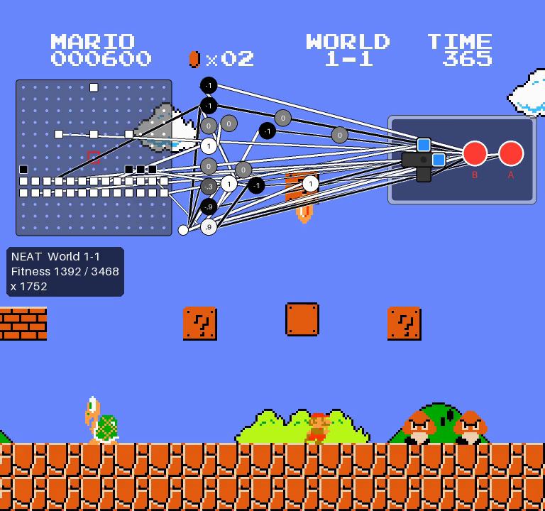

# Step 3: Watching the network think, and recording it

Step 2 produced a network that clears World 1-1, but watching it you only
see Mario. This step draws the network itself over the game, the way MarI/O
does, and saves the result as an .mp4 you can share.

```bash
python scripts/play_neat.py trained/neat-1-1.json                                # live window with the network
python scripts/play_neat.py trained/neat-1-1.json --record videos/neat-1-1.mp4   # ... and save it as a video
python scripts/play_neat.py trained/neat-1-1.json --record videos/neat-1-1.mp4 --no-render   # video only, no window
```

In a Codespace the window appears in the desktop tab (port 6080), as in the
earlier steps. `--no-render` works anywhere, even without a desktop, and
records about as fast as the game can run (about 20 s for the 26 s clip).



## Reading the overlay

The layout follows MarI/O's (`displayGenome` in the Lua script): input grid
on the left, hidden neurons in the middle, buttons on the right, connections
coloured by sign. It fits in a band across the top third of the screen,
under the game's score, coins, world and time, so the lower two thirds
where Mario plays stay clear. The code is `marlio/agents/neat/display.py`.

| what | where | meaning |
|------|-------|---------|
| **Input grid** | dark box, left | The 13 x 13 cells the network sees ([step 1](01-environment-and-inputs.md)). A white square is a solid block, a black square an enemy; empty cells (input 0) are small dots. The red square in the middle is Mario's cell. |
| **Bias** | the small white circle at the grid's bottom-right corner | The input that is always 1, so the network can press buttons even when it sees nothing. |
| **Hidden neurons** | the circles in the middle | Neurons NEAT added during evolution. The number is the neuron's current value (rounded to one decimal: `1`, `.7`, `0`, `-.3`, `-1`) and the shade matches it, from black (-1) through grey (0) to white (+1). |
| **Controller** | right | The 6 outputs drawn as an NES controller. A D-pad arm turns **blue**, and the red **A** or **B** button lights up, while the network holds it. The controller is see-through, so Mario stays visible when he runs behind it. |
| **Connections** | lines | Only connections carrying a signal right now (the neuron feeding them isn't 0) are drawn. **White** = positive weight (the source pushes the target up), **black** = negative (pushes it down). Thicker = stronger weight. Each line has an outline of the opposite shade so it shows on any background. |
| **Info box** | left, under the grid | The level, this run's fitness as it builds up (x reached - frames / 2, +1000 at the flag) next to the genome's fitness from training, and Mario's x position. |

The numbers in the circles are neuron *values* (what each neuron outputs
right now). Weights belong to the connections, and are shown by each line's
colour and thickness.

### One colour rule: white is +, black is -

Everything uses the same rule. A neuron goes from black (-1) through grey (0)
to white (+1); a solid block in the grid is white (+1) and an enemy black
(-1); and a connection with a positive weight is white, one with a negative
weight black. So a white line from a white square means "a block here pushes
this neuron up", and a black line means "pushes it down".

MarI/O itself uses green and red, which are the two colours people with the
most common colour blindness can't tell apart
([Datawrapper](https://www.datawrapper.de/blog/colorblindness-part2)).
White and black differ only in lightness, so everyone sees the difference,
in colour or grey. To keep lines visible on sky, clouds, bricks and the dark
grid alike, white lines get a dark outline and black lines a light one.

### How hidden neurons get their place

Inputs and outputs have fixed places. Hidden neurons have no natural
position, so MarI/O starts them all at one spot and then, 4 times over,
pulls each one a quarter of the way towards the neurons it connects to,
pushing it left of anything it feeds and right of anything that feeds it,
and keeping it inside the middle band. The result roughly reads left to
right, from the grid to the buttons. MarI/O lets neurons land on top of each
other; here a last step nudges overlapping circles apart so every number
can be read. The layout only depends on the genome, so it is computed once
per run.

### Keeping it sharp

The network is drawn at twice the output size and scaled down, which smooths
circles, text and lines. Lines are 1 to 2 screen pixels wide plus their
outline, and being black or white they don't suffer from video compression
storing colour at half resolution (which blurs thin coloured lines).

## Recording

`marlio/video.py` has two small classes that work on plain RGB frames, so
any future agent (PPO, DQN, ...) can reuse them:

* `VideoRecorder(path, fps=60)` writes an H.264 .mp4 (yuv420p, which plays
  in every browser and phone). It uses the ffmpeg binary that the
  `imageio-ffmpeg` package bundles, so nothing needs installing with apt.
* `LiveViewer()` shows frames in the same pyglet window gym-super-mario-bros
  uses, and waits between frames so the game runs at real speed rather
  than as fast as the computer allows.

### Frame rate

The NES draws 60 frames per second, and each `env.step` advances exactly one
frame. So:

* `--fps 60` (default) keeps every frame: real speed, smoothest motion.
* `--fps 30` keeps every other frame: still real speed, about 20% smaller.
* `--fps 20` and `--fps 15` work the same way. Rates that don't divide 60
  (such as 25) are refused, because they would need frames duplicated or
  dropped unevenly and the game would judder.

The 60 fps recording of the trained network is about 26 s (23 s of play
plus a 3 s outro) and about 8 MB at 768 x 720.

### Other options

| option | default | what it does |
|--------|---------|--------------|
| `--scale` | 3 | Enlarges the 256 x 240 NES screen (3 gives 768 x 720). The overlay is drawn at full size, so text and lines stay sharp. |
| `--no-overlay` | off | Shows or records the plain game. |
| `--outro` | 3 | Seconds to keep the game running after the flag (no buttons pressed), so the video ends with Mario sliding down the pole and walking to the castle instead of cutting off mid-jump. |
| `--runs` | 1 | Plays several times in a row. |

## How it fits in

* `run_genome` (step 2) gained an optional `on_frame(agent, info)` callback
  that's called after every frame. `play_neat.py` uses it to draw and
  record, so the replay runs exactly the same loop, and gets exactly the
  same score, as training did (3467.5 for the trained network).
* `NetworkDisplay(genome, network)` draws the network's *current* neuron
  values, which the `Network` from step 2 already keeps between frames.
* The network's picture is redrawn only when its values change (when it
  thinks, every 5 frames), and only the part of the screen it covers is
  blended, which keeps the live window at 60 fps (measured: 25.6 s to show
  24.1 s of game, in a virtual display).
