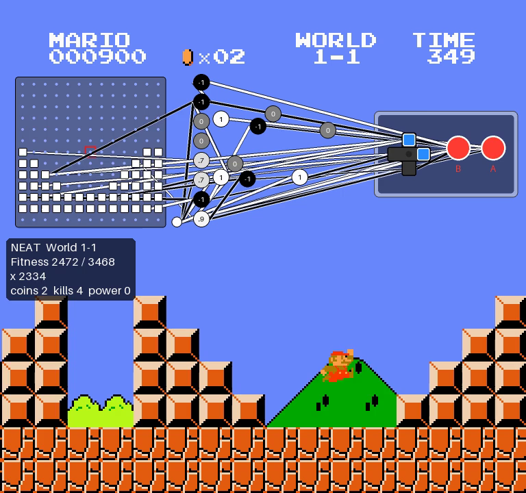

# Step 5a: a fitness for any level

Before training harder levels we changed how a run is scored. MarI/O's
fitness only looked at how far right Mario got. The new one, in
`marlio/fitness.py`, scores what a good player does on **every** level: go
right, reach the flag, collect coins, grab power-ups, stomp enemies, and
don't get hurt or die. Nothing in it is specific to one level.

This is option A of the research in the project files
(`marlio-fitness/fitness-options.md`). The next step adds a novelty score
(option C) on top.

## The old fitness (MarI/O's)

```
fitness = rightmost x - frames / 2      (+1000 if flag_get or rightmost x > 3186)
```

Two problems showed up on World 2-1:

1. **Waiting scored worse than dying.** The piranha pipe at x~1950 needs
   Mario to wait for the plant to go down. Running in and dying at frame
   1000 scored `1950 - 500 = 1450`. Waiting 200 frames and getting 50 px
   further scored `2000 - 600 = 1400`, which is lower. Evolution was pushed
   away from the behaviour the level needs.
2. **3186 is World 1-1's flag.** On other levels the +1000 was given at the
   wrong place (or never).

## The new fitness

Every term is measured in **pixels of progress**, so each weight reads as
"this is worth going N px further right":

```
fitness = rightmost x                       progress (still the main driver)
        - frames      x 0.1                 time: waiting 200 frames costs 20
        + coins       x 20
        + kills       x 50                  stomped, or hit by a fireball / shell
        + power-ups   x 200                 mushroom, fire flower
        - hits        x 100                 hurt by an enemy (shrinks, doesn't die)
        - 100 if Mario died                 enemy, pit, or the clock
        + 1000 if Mario reached the flag    the game's flag_get
```

The weights are constants at the top of `marlio/fitness.py`
(`TIME_PENALTY`, `COIN_BONUS`, `KILL_BONUS`, ...).

Why these sizes:

- **Progress stays the main driver.** A level is about 3,000 px long, while
  all the coins and enemies on it are worth a few hundred. A network can't
  get a high score by farming coins and never moving on.
- **The flag is the biggest single bonus**, so clearing the level is always
  the goal.
- **Dying costs 100, more than any single good thing except a power-up or the flag.**
  Stopping safely in front of a danger now beats walking into it a little
  further on.
- **Time is cheap** (1/10 per frame instead of 1/2), so waiting a few seconds
  for an enemy is fine, but a faster run still wins.

The run still ends the way it did in MarI/O: on death, at the flag, or after
`20 + frames/4` frames with no new rightmost point.

## Where each number comes from

`RunStats` follows the run frame by frame:

| Term | Read from | How |
|---|---|---|
| progress | `info["x_pos"]` | the furthest x so far |
| coins | `info["coins"]` | the counter's increase (it wraps from 99 to 0) |
| power-ups | `info["status"]` | small -> tall -> fireball: each step up is a power-up |
| hits | `info["status"]` | a step down without dying |
| kills | RAM `0x1E-0x22` (Enemy_State, one byte per enemy slot) | a slot gaining bit `0x04` (stomped) or `0x20` (knocked out by fire, shell or star) |
| died | `info["is_dying"]`, `info["is_dead"]` | pits count too |
| flag | `info["flag_get"]` | |

The kill count was checked against the game's own score: in every saved run,
each stomp the counter saw matched a +100/+200 score event.

## The saved genomes, re-scored

Same runs, nothing retrained:

| Genome | x | coins | kills | died | old | new |
|---|---|---|---|---|---|---|
| `trained/neat-1-1.json` (clears 1-1) | 3161 | 2 | 4 | no | 3467.5 | 4262.3 |
| 2-1 seed 2 best | 1950 | 0 | 5 | yes | 1489.0 | 2007.8 |
| 2-1 fresh (practice) best | 1734 | 1 | 2 | yes | 1346.5 | 1676.5 |

Both 2-1 champions get their score by running into the piranha plant and
dying, which the death penalty now discourages.

Old and new scores can't be compared, so `train_neat.py --resume` now
re-scores every genome of a saved population on its first generation.

## In the overlay

The info box shows the live score and a new line with what the run has
collected so far:



## Trade-offs

- The weights are hand-picked. A larger death or hit penalty makes the
  population more careful; too large and "stop before every enemy" becomes
  a new dead end. That plateau is what the next step, a novelty score, is
  for.
- Kills are worth chasing only a little. If a network starts hunting
  enemies instead of moving on, lower `KILL_BONUS`.
- A stomped Koopa that wakes up and is stomped again counts twice. It's
  rare, and costs time, so it isn't worth special handling.
- With a smaller time penalty, the winning run on an easy level like 1-1 may
  be a little slower than MarI/O's.
